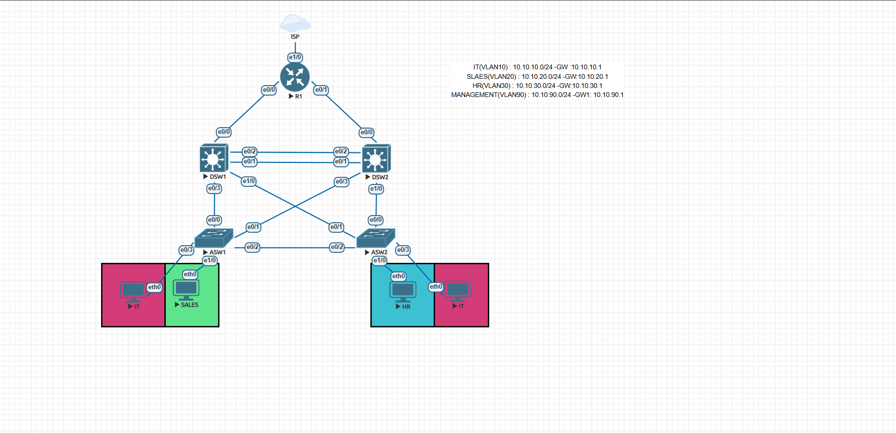
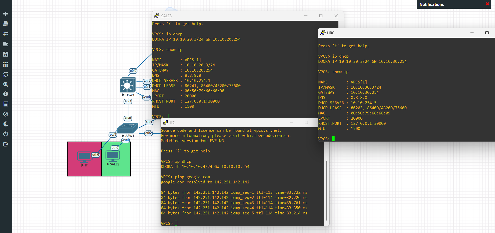

# MOHTECH Solutions | Enterprise Network Infrastructure

**A redundant enterprise network designed and implemented using Cisco technologies in EVE-NG.**

This project builds on the MOHTECH Solutions company scenario introduced in a previous project. It focuses on designing and implementing an enterprise network infrastructure for the organization in a simulated EVE-NG environment.

The project demonstrates practical networking concepts including network segmentation, redundancy, dynamic routing, and Internet connectivity.

---

## Network Topology

---

## Technical Overview

| Category | Implementation |
|---|---|
| Environment | EVE-NG |
| Network Devices | 1 Router, 2 Distribution Switches, 2 Access Switches |
| Network Design | Two-Tier Campus Architecture |
| Routing Protocol | OSPF |
| Gateway Redundancy | HSRP |
| Loop Prevention | RSTP |
| Link Aggregation | EtherChannel |
| IP Allocation | DHCP |
| External Connectivity | NAT/PAT |

## Network Architecture

The internal switching infrastructure follows a **two-tier campus architecture**, consisting of a Distribution Layer and an Access Layer.

| Tier | Devices | Main Responsibilities |
|---|---|---|
| Distribution | DSW1, DSW2 | Inter-VLAN routing, HSRP, OSPF, RSTP |
| Access | ASW1, ASW2 | End-device connectivity and VLAN assignment |

R1 operates as the edge router, providing upstream connectivity between the internal network and the ISP.

## VLAN & IP Addressing

Four VLANs were created to separate the organization's departments and management traffic.

| VLAN | Department | Network | HSRP Virtual Gateway |
|---|---|---|---|
| 10 | IT | 10.10.10.0/24 | 10.10.10.254 |
| 20 | Sales | 10.10.20.0/24 | 10.10.20.254 |
| 30 | HR | 10.10.30.0/24 | 10.10.30.254 |
| 90 | Management | 10.10.90.0/24 | 10.10.90.254 |

## Key Technologies

| Technology | Implementation |
|---|---|
| VLANs | Departmental network segmentation |
| Inter-VLAN Routing | Communication between VLANs |
| HSRP | Redundant default gateways |
| RSTP | Rapid Layer 2 loop prevention and convergence |
| EtherChannel | Aggregated links between distribution switches |
| OSPF | Dynamic routing |
| DHCP | Automatic IP address allocation |
| NAT/PAT | Internet access for internal networks |

### Redundancy Design

Gateway responsibilities are distributed across the two distribution switches:

- **DSW1:** Active gateway for VLANs 10 and 20.
- **DSW2:** Active gateway for VLANs 30 and 90.

The HSRP virtual gateway addresses are configured using the `.254` address in each VLAN subnet.

RSTP root bridge placement is aligned with the HSRP active gateway roles to help optimize Layer 2 forwarding paths.

## Implementation Workflow

The network was built in the following stages:

1. **Topology Design** – Planned the network architecture, devices, links, VLANs, and IP addressing.
2. **Switching Configuration** – Created VLANs, configured access ports and trunks, and implemented EtherChannel.
3. **Layer 3 Configuration** – Configured inter-VLAN routing and HSRP on the distribution switches.
4. **Routing** – Implemented OSPF between the distribution layer and edge router.
5. **Network Services** – Configured DHCP on R1 and NAT/PAT for external connectivity.
6. **Verification** – Tested address allocation, connectivity, routing, and Internet access.

## Connectivity & DHCP Verification

The following screenshot demonstrates successful DHCP address allocation and connectivity testing from the network hosts.

- **DHCP:** Hosts successfully obtained IP addresses from the DHCP server running on R1.
- **Connectivity:** Successful ping tests confirmed network reachability from the hosts.

## Verification Summary

| Test | Result |
|---|---|
| DHCP Address Allocation | Verified |
| Host Connectivity (Ping) | Verified |
| Internet Connectivity | Verified |
| OSPF Routing | To be documented |
| HSRP Failover | Pending |
| RSTP Convergence | Pending |
| EtherChannel Failover | Pending |

*Verification statuses should be updated as additional tests are completed and their results are documented.*

## Project Files

| Directory | Contents |
|---|---|
| `Lab/` | EVE-NG lab file |
| `Configurations/` | Running configurations for all network devices |
| `Documentation/` | Network documentation and addressing plan |
| `Verification/` | Command outputs and test results |

### Device Configurations

- [R1 Configuration](Configurations/R1.txt)
- [DSW1 Configuration](Configurations/DSW1.txt)
- [DSW2 Configuration](Configurations/DSW2.txt)
- [ASW1 Configuration](Configurations/ASW1.txt)
- [ASW2 Configuration](Configurations/ASW2.txt)

### Documentation

- [IP Addressing Plan](Documentation/IP-Addressing-Plan.xlsx)

## Lab Environment

The project was implemented in EVE-NG using virtual Cisco network devices.

The lab file is provided for anyone who wants to explore the topology and configurations. Compatible device images are required to run the lab.

## Future Improvements

- Complete and document HSRP failover testing.
- Test RSTP convergence after link and switch failures.
- Test EtherChannel member-link failure.
- Add detailed troubleshooting scenarios.
- Expand network monitoring and management.
- Integrate Windows Server and Active Directory services.

---

**Focus Areas:** Enterprise Networking · Routing & Switching · Network Redundancy · Cisco IOS · EVE-NG
